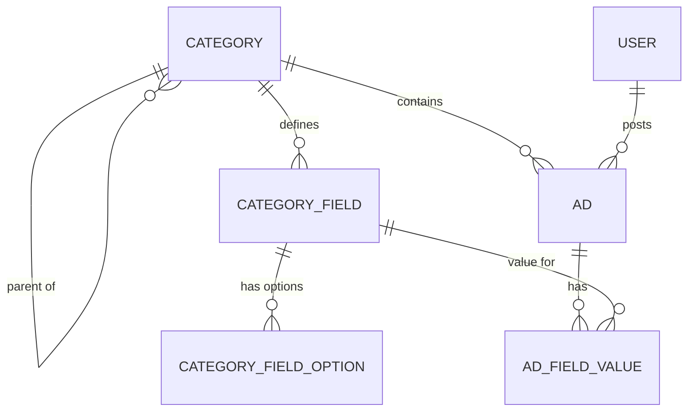

# Classified Ads API

A Laravel 12 REST API for classified ads whose categories each define their own fields, seeded with real category and field data from OLX Lebanon.

On a classifieds site, a car listing needs a make, year, and mileage, while an apartment listing needs bedrooms and a property type. Hardcoding a schema for every category doesn't scale. This API stores each category's fields and allowed options as data, builds validation rules for an ad at request time from its category, and returns helpful errors that list the fields the category accepts.

## Features

- **Dynamic category fields**: each category defines typed fields (`text`, `number`, `date`, `select`, `radio`, `checkbox`) with required flags, options, and optional custom validation rules.
- **Validation built per request**: `StoreAdRequest` generates rules for `fields.*` from the selected category, including `in:` constraints for select and radio options.
- **Helpful errors**: a `422` response includes a `help` block with the category, its available fields, which ones are required, the valid options, and the endpoint for fetching them.
- **OLX Lebanon integration**: the seeder pulls categories (including parent/child relationships), fields, and options from the OLX Lebanon API.
- **Cached upstream data**: OLX responses are cached for 24 hours. With Redis or Memcached the cache is tag-based, and other drivers fall back to per-key caching. The `olx:clear-cache` command clears it.
- **Token auth**: Laravel Sanctum handles register, login, and logout, and issues bearer tokens.
- **Ad browsing**: paginated listing with `category_id`, `status`, and free-text `search` (title or description) filters, plus a "my ads" endpoint.
- **Transactional writes**: an ad and its field values are created in a single database transaction.
- **Clean structure**: Actions for business logic, Repositories for data access, Form Requests for validation, and API Resources for response formatting.
- **Docker setup**: PHP-FPM, Nginx, and Supervisor in the app container, with MySQL 8, Redis 7, and phpMyAdmin alongside.
- **Postman collection** with ready-made requests and an auto-set token.

## Tech Stack

PHP 8.4 · Laravel 12 · Laravel Sanctum · MySQL 8 · Redis 7 · Nginx · Supervisor · Docker Compose · PHPUnit

## Architecture

```
app/
├── Actions/            # Business logic (Ad, Auth, Category)
├── Repositories/       # Data access (AdRepository, CategoryRepository)
├── Services/           # OlxApiService: external API + caching
├── Http/
│   ├── Controllers/Api/V1/  # AdController, AuthController, CategoryController
│   ├── Requests/       # StoreAdRequest (dynamic rules), GetAdsRequest, Login/Register
│   └── Resources/      # AdResource, CategoryResource, CategoryFieldResource, UserResource
├── Models/             # Ad, AdFieldValue, Category, CategoryField, CategoryFieldOption, User
└── Console/Commands/   # olx:clear-cache
```



## API Overview

Base URL: `http://localhost:8000/api/v1`

| Method | Path | Auth | Purpose |
|---|---|---|---|
| `POST` | `/register` | – | Register a user and return a token |
| `POST` | `/login` | – | Log in and return a token |
| `POST` | `/logout` | Bearer | Revoke the current token |
| `GET` | `/categories` | – | List categories |
| `GET` | `/categories/{id}/fields` | – | A category's fields and options |
| `GET` | `/ads` | – | Paginated ads (`per_page` ≤ 100, `category_id`, `status`, `search`) |
| `GET` | `/ads/{id}` | – | A single ad |
| `POST` | `/ads` | Bearer | Create an ad with dynamic fields |
| `GET` | `/my-ads` | Bearer | The authenticated user's ads (paginated) |

### Creating an ad

Each category has different fields, so check them first:

```bash
GET /categories/2/fields
```

Then create the ad:

```json
{
  "category_id": 2,
  "title": "2020 Toyota Camry",
  "description": "Well maintained",
  "price": 15000,
  "fields": {
    "make": "36",
    "year": 2020,
    "mileage": 35000,
    "petrol": "1",
    "transmission": "1",
    "body_type": "2",
    "color": "1",
    "new_used": "2",
    "price_type": "price"
  }
}
```

If a field is missing or invalid, the `422` response lists the category's available fields and the valid options for each.

## Getting Started

### Requirements

- PHP 8.4+, Composer, and MySQL

**or**

- Docker and Docker Compose

### Option 1: Local setup

```bash
composer install

cp .env.example .env
php artisan key:generate
```

Configure the database in `.env`:

```env
DB_DATABASE=your_database
DB_USERNAME=your_username
DB_PASSWORD=your_password
```

Run migrations and seed with OLX data:

```bash
php artisan migrate
php artisan db:seed
```

Start the server:

```bash
php artisan serve
# Base URL: http://localhost:8000/api/v1
```

### Option 2: Docker

**Automated script:**

```bash
chmod +x docker-setup.sh
./docker-setup.sh
```

The script performs these steps:

1. Copies `.env.docker` to `.env` if `.env` doesn't exist.
2. Builds and starts the containers.
3. Installs Composer dependencies and generates the app key.
4. Runs migrations and seeds the categories and fields.
5. Caches the config.

**Manual:**

```bash
cp .env.example .env              # or: cp .env.docker .env
docker-compose up -d
docker-compose exec app composer install
docker-compose exec app php artisan key:generate
docker-compose exec app php artisan migrate
docker-compose exec app php artisan db:seed
```

> Inside the Compose network, MySQL is reachable at host `db` on port `3306`. Port `3307` is only the host-side mapping. If migrations can't connect from the container, set `DB_HOST=db` and `DB_PORT=3306` in `.env`.

**Services:**

| Service | URL |
|---|---|
| API | http://localhost:8000 |
| phpMyAdmin | http://localhost:8080 (user `laravel`, password `secret`) |
| MySQL | localhost:3307 |
| Redis | localhost:6379 |

**Useful commands:**

```bash
docker-compose down                                        # stop containers
docker-compose logs -f app                                 # view logs
docker-compose exec app bash                               # shell into the app container
docker-compose exec app php artisan [command]              # run artisan
docker-compose exec app php artisan migrate:fresh --seed   # reset + reseed
```

### Database seeding

The seeder fetches live data from the OLX Lebanon API: parent categories and subcategories, each category's fields (make, year, bedrooms, etc.), and the field options (car brands, colors, property types, etc.).

```bash
php artisan db:seed                     # seed
php artisan migrate:fresh --seed        # drop everything and reseed
# Docker: prefix with `docker-compose exec app`
```

OLX data is cached for 24 hours. To clear the cache and fetch fresh data:

```bash
php artisan olx:clear-cache             # asks for confirmation
php artisan olx:clear-cache --force     # skip confirmation
php artisan olx:clear-cache --stats     # show cache stats first
```

### Postman

Import `Classified_Ads_API.postman_collection.json`. It includes requests for registering and logging in, browsing categories and fields, creating ads (cars, apartments, and a validation-error example), and fetching your ads.

Set these collection variables:

- `base_url`: `http://localhost:8000/api/v1`
- `token`: set automatically after login

### Tests

```bash
php artisan test                                 # local
docker-compose exec app php artisan test         # Docker
vendor/bin/phpunit                               # PHPUnit directly
```

Tests run against in-memory SQLite. They cover ad creation and validation (including unauthenticated access) and OLX caching (caching, cache clearing, stats, the artisan command, and the health check).

### Common issues

**Docker: permission denied on storage**

```bash
docker-compose exec app chmod -R 775 storage bootstrap/cache
docker-compose exec app chown -R www-data:www-data storage bootstrap/cache
```

**Seeding fails with "Connection refused":** make sure the database is running and the credentials in `.env` are correct.

**Port already in use:** change the ports in `docker-compose.yml` if 8000, 8080, or 3307 are taken.

## License

MIT

---

Built by [Chadi Choker](https://github.com/ChadiChoker) · [Portfolio](https://github.com/ChadiChoker/portfolio)
